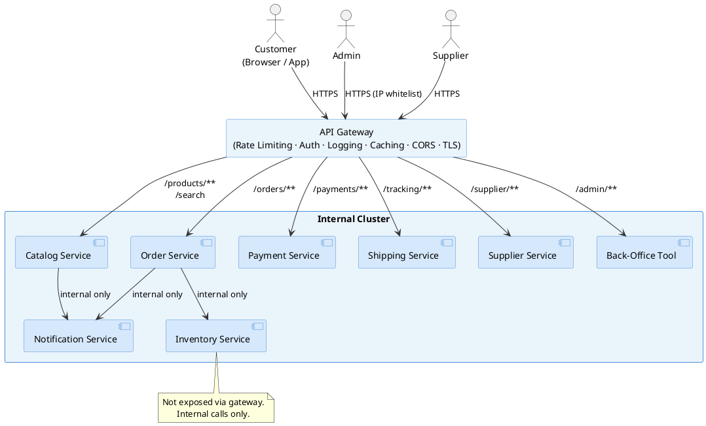

# ✅ Lab AG-01 — Solution: Cross-Cutting Concerns & Gateway Design

> 🗂️ Topic: API Gateway &nbsp;|&nbsp; 📐 Artifacts: Concern Map · Gateway Design · Solution Recommendation &nbsp;|&nbsp; 🔒 Trainer Reference

---

## 🔍 Step 1 — Cross-Cutting Concerns

| 🏷️ Concern | 📋 What it does & why it is needed | 🟢 Benefit of centralising at the gateway |
|---|---|---|
| **Authentication** | Validates that the caller has a valid identity (e.g. checks a Bearer token issued by the identity provider) | Token validation logic lives in one place — services receive pre-validated caller identity in request headers |
| **Authorisation** | Enforces access control rules — does this caller have the right scope or role for this endpoint? | Coarse-grained access control (e.g. admin-only routes) enforced at the edge without reaching services |
| **Rate Limiting** | Limits the number of requests a client can make in a given time window to protect services from overload | Consistent rate limiting across all services without per-service implementation |
| **Request Logging / Audit Trail** | Records all inbound requests for observability, debugging, and compliance | Centralised, consistent log format across all services; no per-service logging boilerplate |
| **SSL/TLS Termination** | Handles HTTPS decryption at the gateway — internal service-to-service traffic can use plain HTTP inside the cluster | Services do not need to manage TLS certificates; certificate rotation is centralised |
| **CORS** | Adds the correct `Access-Control-Allow-*` headers for browser-based clients making cross-origin requests | CORS policy managed in one place — no risk of inconsistency across services |
| **Request Routing** | Maps external URL paths to the correct internal service and port | Clients need only know the gateway URL — internal service topology is hidden |
| **Response Caching** | Caches responses for read-heavy, low-volatility endpoints (e.g. product catalog) | Reduces load on backend services during high traffic without any service-level changes |
| **Bot Detection / IP Whitelist** | Detects and blocks malicious traffic patterns; restricts admin routes to known IP ranges | Security rules applied uniformly without touching service code |
| **Protocol Translation** | Translates external REST calls to internal gRPC if needed | Services can use optimised internal protocols while clients use standard HTTP/REST |

---

## 🗺️ Step 2 — Gateway Design

### External Route Table

| 🌐 External Path | 🔀 Internal Service | 🛡️ Policies Applied |
|---|---|---|
| `GET /products/**` | Catalog Service | Rate limiting, response caching (5-min TTL), request logging |
| `GET /search?q=*` | Catalog Service | Rate limiting, request logging |
| `POST /orders` | Order Service | Authentication, authorisation (scope: `orders:write`), rate limiting, request logging |
| `GET /orders/{id}` | Order Service | Authentication, authorisation (scope: `orders:read`), request logging |
| `PATCH /orders/{id}/cancel` | Order Service | Authentication, authorisation (scope: `orders:write`), request logging |
| `GET /customers/{id}/orders` | Order Service | Authentication, authorisation (scope: `orders:read`), request logging |
| `GET /tracking/{shipmentId}` | Shipping Service | Authentication, request logging |
| `POST /payments/**` | Payment Service | Authentication, authorisation (scope: `payments:write`), rate limiting, audit logging |
| `/admin/**` | Back-Office Tool | Authentication, authorisation (role: `admin`), IP whitelist, audit logging |
| `/supplier/**` | Supplier Service | Authentication, authorisation (role: `supplier`), rate limiting, request logging |

### 🚫 Internal-Only Services (not exposed via gateway)

| Service | Reason |
|---|---|
| Inventory Service | Internal only — called by Order Service; should never be reachable directly from outside |
| Notification Service | Internal only — triggered by events; no external API |
| Marketing Service | Internal only — receives data from Customer Service; no public API |

### PlantUML — Gateway Architecture

> 🔗 Visualize this diagram at **https://editor.plantuml.com/** — paste the code below into the editor.

---

## 🔎 Step 3 — Solution Evaluation & Recommendation

### Evaluation Cards

| 🏷️ Solution | ✅ Key Strengths | ❌ Limitations / Trade-offs | 💰 Licensing |
|---|---|---|---|
| **Kong** | Extremely plugin-rich; Kubernetes-native (Ingress Controller); large community; supports all required concerns out of the box; open-source core | Operationally complex to manage; Enterprise features (RBAC, portal) require paid license; steeper learning curve | Open source (Kong CE) / Commercial (Kong Enterprise) |
| **AWS API Gateway** | Fully managed — no infrastructure to operate; tight AWS integration (Lambda, IAM, CloudWatch); scales automatically | AWS lock-in; limited plugin flexibility; can become expensive at high request volumes; not portable to other clouds | Pay-per-request managed service |
| **Azure API Management** | Fully managed; strong enterprise features (developer portal, analytics, policy engine); good for B2B scenarios like the supplier portal | Azure lock-in; complex pricing; policy language (XML-based) has a learning curve | Tiered managed service (consumption / standard / premium) |
| **Traefik** | Lightweight; excellent Kubernetes integration via Ingress; automatic service discovery; zero-downtime deploys | Fewer built-in plugins than Kong; less mature for complex API management use cases | Open source (Traefik CE) / Commercial (Traefik Enterprise) |
| **nginx** | Battle-tested; extremely performant; very flexible; widely known | Requires manual configuration and maintenance; no native API management features (rate limiting, auth require plugins or custom Lua scripts) | Open source / NGINX Plus (commercial) |

### 🏆 Recommendation Card

| Field | Value |
|---|---|
| 🏆 **Recommended Solution** | **Kong** (Community Edition to start, Enterprise when operational maturity allows) |
| 🎯 **Key Reasons** | All required cross-cutting concerns (auth, rate limiting, logging, caching, bot detection) are available as production-ready plugins. Kubernetes-native deployment fits a microservice architecture. Cloud-agnostic — ShopFast can run on any cloud provider or on-premise. |
| ⚠️ **Main Risk** | Kong requires dedicated operational knowledge. A small team without Kong expertise may find the initial setup and ongoing maintenance demanding. Consider starting with a managed alternative (AWS API Gateway or Azure APIM) if the team is cloud-committed and lacks platform experience. |

---

## 💡 Trainer Notes

- Groups often forget **SSL/TLS termination** as a gateway concern. It is invisible but fundamental — remind them that without it, every service needs its own certificate management.
- The **internal-only services** discussion is important. If Inventory is accidentally exposed via the gateway, any external caller could manipulate stock levels. The gateway as a security perimeter is as important as what it allows as what it blocks.
- On the solution recommendation: there is no wrong answer, but the **assumptions must be explicit**. A team going all-in on AWS should recommend AWS API Gateway. A cloud-agnostic team should choose Kong or Traefik. Push groups to state their assumptions before recommending.
- Some groups may propose building a custom gateway. This is almost never the right choice — redirect the discussion to the operational burden and the time-to-market cost.
- The **caching policy** for the catalog endpoint is worth dwelling on: what is an acceptable TTL? 5 minutes? 1 hour? This connects back to the consistency vs. availability trade-off from the microservices section.
