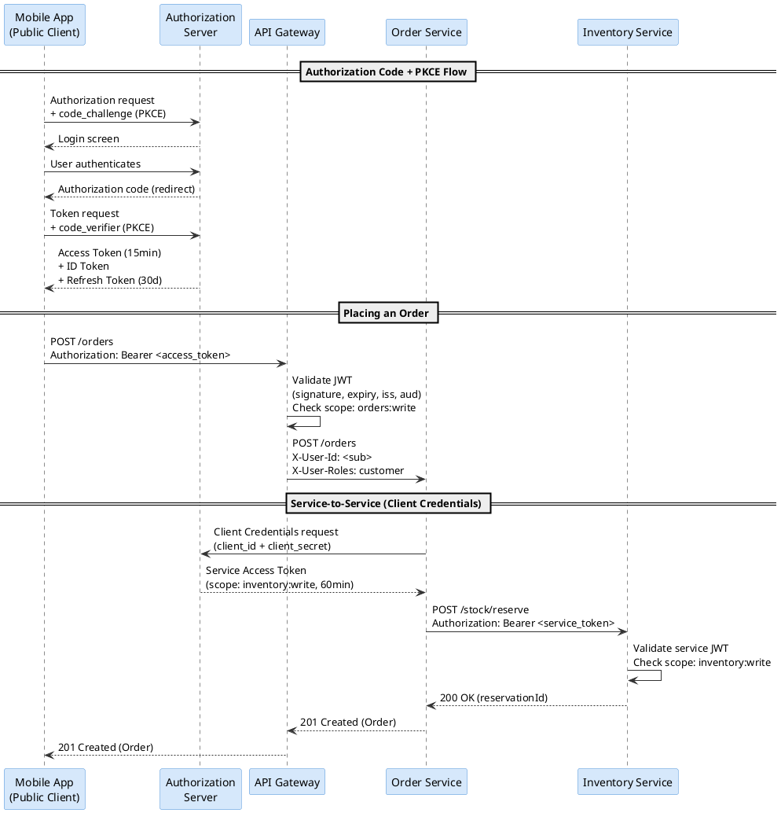

# ✅ Lab AG-03 — Solution: End-to-End Security with OAuth 2.0 & OIDC

> 🗂️ Topic: API Gateway · Security &nbsp;|&nbsp; 📐 Artifact: End-to-End Security Concept &nbsp;|&nbsp; 🔒 Trainer Reference

---

## 🔑 Step 1 — Grant Types per Client

| 📱 Client | 🔖 Type | 🔑 Grant Type | ✅ Justification | 🔒 PKCE Required? |
|---|---|---|---|---|
| **ShopFast Web Frontend** | Browser-based SPA | Authorization Code + PKCE | Public client — cannot store a client secret securely in a browser. PKCE protects the authorization code from interception. | ✅ Yes — public client in browser, cannot use client secret |
| **ShopFast Mobile App** | Native application | Authorization Code + PKCE | Native apps cannot securely store secrets (the binary can be reverse-engineered). PKCE replaces the client secret for public clients. | ✅ Yes — native app is a public client |
| **Admin Back-Office Tool** | Server-side web application | Authorization Code (confidential client) | Server-side application can securely store a client secret. PKCE is still recommended as defence-in-depth but not strictly required. | Recommended but not strictly required |
| **Supplier Portal** | Server-side web application | Authorization Code (confidential client) | Same as Admin Tool — server-side, can store secrets. External users (suppliers) authenticate via the identity provider. | Recommended |
| **Microservice-to-Microservice** | Background service | Client Credentials | No user (resource owner) is involved. The service authenticates as itself using its own client ID and secret. No front channel is used. | ❌ No — no user interaction, back channel only |

---

## 🏷️ Step 2 — Scope Definitions

| 🏷️ Scope | 📋 What it grants | 👤 Typical Requestors | 🔒 Elevated Privileges? |
|---|---|---|---|
| `catalog:read` | Read product listings, descriptions, pricing, and search | Web Frontend, Mobile App, Admin Tool | ❌ No — public read access |
| `orders:read` | Read own orders and order history | Web Frontend, Mobile App | ❌ No |
| `orders:write` | Place new orders and cancel own orders | Web Frontend, Mobile App | ❌ No |
| `orders:admin` | Read and update any customer's order | Admin Tool | ✅ Yes — admin role required |
| `inventory:read` | Read stock levels for SKUs | Admin Tool, Order Service (service token) | ✅ Yes — internal service scope |
| `inventory:write` | Update stock levels and manage reservations | Order Service, Supplier Service (service tokens) | ✅ Yes — internal service scope |
| `shipping:read` | Read shipment status and tracking information | Web Frontend, Mobile App, Order Service | ❌ No |
| `shipping:admin` | Trigger shipment dispatch and update delivery status | Shipping Service (service token) | ✅ Yes — internal service scope |
| `customers:read` | Read own customer profile and delivery addresses | Web Frontend, Mobile App | ❌ No |
| `customers:admin` | Read and update any customer profile | Admin Tool | ✅ Yes — admin role required |
| `suppliers:write` | Register new products and update delivery quantities | Supplier Portal | ✅ Yes — supplier role required |
| `notifications:write` | Trigger transactional notifications | Order Service, Shipping Service (service tokens) | ✅ Yes — internal service scope |

---

## 🪪 Step 3 — OIDC Identity Layer

### Standard & Custom Claims

| 🏷️ Claim | 🔖 Type | 📋 Meaning | 📦 Location | 🔗 Required Scope |
|---|---|---|---|---|
| `sub` | Standard | Unique identifier for the user (immutable) | ID Token | `openid` |
| `email` | Standard | User's email address | ID Token | `email` |
| `email_verified` | Standard | Whether the email address has been verified | ID Token | `email` |
| `name` | Standard | Full display name | ID Token | `profile` |
| `given_name` | Standard | First name | ID Token | `profile` |
| `family_name` | Standard | Last name | ID Token | `profile` |
| `preferred_username` | Standard | Username or handle | ID Token | `profile` |
| `roles` | Custom | Array of roles assigned to the user, e.g. `["customer"]`, `["admin"]`, `["supplier"]` | ID Token | `openid` |
| `customer_tier` | Custom | Loyalty tier of the customer: `bronze`, `silver`, or `gold` | UserInfo endpoint | `profile` |
| `account_status` | Custom | Account state: `active`, `suspended`, or `pending_verification` | UserInfo endpoint | `profile` |
| `shopfast_customer_id` | Custom | ShopFast-internal customer UUID (distinct from `sub`) | ID Token | `openid` |

### ID Token vs. UserInfo Split

| 📦 ID Token (always returned) | 🌐 UserInfo Endpoint (fetched on demand) |
|---|---|
| `sub`, `email`, `email_verified`, `name`, `roles`, `shopfast_customer_id` | `given_name`, `family_name`, `preferred_username`, `customer_tier`, `account_status`, postal address |

> **Rationale:** The ID token is sent on every request — keep it small. Only include what the client needs immediately after login. Fetch richer profile data from UserInfo when the user navigates to their profile page.

---

## 🔄 Step 4 — Token Lifecycle

| 📱 Client | ⏱️ Access Token Lifetime | 🔄 Refresh Token | ❌ Revocation Trigger | 🔁 Re-authentication |
|---|---|---|---|---|
| **Web Frontend** | 15 minutes | Issued — 7 days (rolling); used silently in background | User clicks logout; account suspended | After refresh token expires or is revoked |
| **Mobile App** | 15 minutes | Issued — 30 days (rolling); used silently; stored in secure device storage | User logs out; device lost (revoke all tokens); account suspended | After refresh token expires or is revoked |
| **Admin Back-Office Tool** | 5 minutes | Issued — 8 hours (non-rolling, expires at end of working day) | User logs out; admin session timeout (30 min inactivity) | After 8 hours or inactivity timeout |
| **Supplier Portal** | 15 minutes | Issued — 8 hours; expires at end of working day | User logs out; supplier account deactivated | After 8 hours |
| **Microservice-to-Microservice** | 60 minutes | Not issued — service re-authenticates via Client Credentials on expiry | Service credential rotation | Automatic — client credentials flow is stateless |

---

## 🏛️ Step 5 — End-to-End Security Flow

### Scenario: Mobile App customer logs in and places an order; Order Service calls Inventory Service internally.

| # | Step | 🔐 Flow / Grant Type | 🎟️ Token Used | 🛡️ Validation Location | 🏷️ Scopes / Claims Checked |
|---|---|---|---|---|---|
| 1 | Customer opens the app and taps "Login" | Authorization Code + PKCE (front channel) | None yet — initiating flow | — | — |
| 2 | App generates `code_verifier` and `code_challenge`; redirects to Authorization Server | PKCE challenge sent | None | Authorization Server | — |
| 3 | Customer authenticates (username + password or biometrics) at the Authorization Server | — | None | Authorization Server (authenticates user) | — |
| 4 | Authorization Server returns authorization code to app via redirect | Front channel | Authorization code (short-lived, single use) | App stores code | — |
| 5 | App exchanges code + `code_verifier` at token endpoint (back channel) | Authorization Code back channel | Authorization code | Authorization Server (validates PKCE) | `openid`, `orders:write`, `orders:read`, `catalog:read` |
| 6 | Authorization Server returns Access Token, ID Token, and Refresh Token | — | Access Token (15 min), ID Token, Refresh Token (30 days) | App stores tokens securely | — |
| 7 | App calls `POST /orders` via API Gateway, presenting Bearer Access Token | REST | Access Token | **API Gateway**: validates JWT signature, checks expiry, checks issuer (`iss`), checks audience (`aud`) | `orders:write` scope verified |
| 8 | API Gateway forwards request to Order Service with validated claims in headers (`X-User-Id`, `X-User-Roles`) | — | Claims forwarded as headers | **Order Service**: trusts gateway-validated headers; checks `shopfast_customer_id` matches order owner | `orders:write`, `roles: customer` |
| 9 | Order Service calls `POST /stock/reserve` on Inventory Service (internal) | Client Credentials (back channel) | Service Access Token (60 min, scoped to `inventory:write`) | **Inventory Service**: validates service token JWT; checks `aud` is Inventory Service | `inventory:write` scope |
| 10 | Inventory confirms reservation; Order Service returns `201 Created` to gateway and app | — | — | — | — |

### PlantUML — End-to-End Security Flow

> 🔗 Visualize this diagram at **https://editor.plantuml.com/** — paste the code below into the editor.

---

## 💡 Trainer Notes

- The most common mistake is **using the ID Token to call APIs**. The ID Token is for the client to identify the user — it should never be sent as a Bearer token to a resource server. The Access Token is for API calls. Stress this distinction clearly.
- **PKCE for SPAs and mobile apps** is no longer optional — it is the current best practice (RFC 9700 deprecates the Implicit flow). Groups may propose Implicit flow for the browser app; redirect them to Authorization Code + PKCE.
- The **service-to-service Client Credentials** call is often forgotten by groups. Ask: *when Order Service calls Inventory Service, whose identity does it present?* The answer is the service's own identity — not the customer's token.
- Some groups propose passing the customer's access token along to internal services ("token forwarding"). This is a valid pattern (called **token delegation** or **on-behalf-of flow**) but introduces complexity and coupling. For ShopFast, passing claims via headers from the gateway is simpler and sufficient.
- **Token lifetime** discussions are productive: why is the admin token shorter (5 min) than the customer token (15 min)? Because admin operations carry higher risk — shorter-lived tokens limit the blast radius of a stolen admin token.
- The **Refresh Token** for mobile apps being 30 days is intentional — it matches user expectations for "staying logged in" on a phone without being prompted every 15 minutes.
