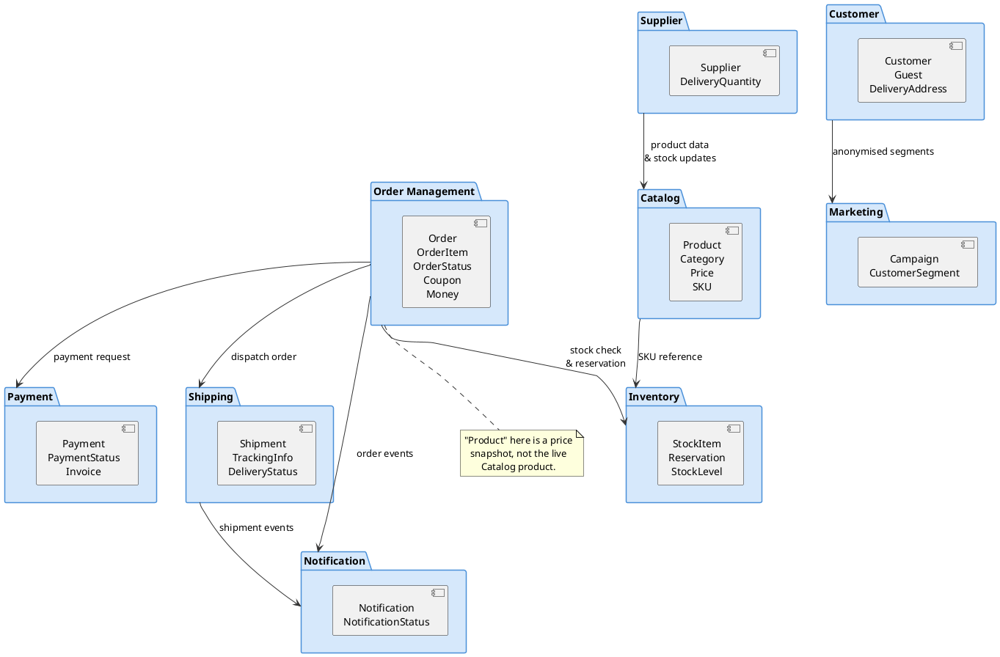

# ✅ Lab D-01 — Solution: Understanding the Domain

> 🗂️ Topic: Domain-Driven Design &nbsp;|&nbsp; 📐 Artifacts: Ubiquitous Language · Bounded Contexts &nbsp;|&nbsp; 🔒 Trainer Reference

---

## 📖 Step 1 — Ubiquitous Language Glossary

| 🏷️ Term | 📝 Definition | ❓ Ambiguities / Open Questions |
|---|---|---|
| **Customer** | A person who has registered an account with ShopFast and can place orders, view order history, and manage their profile. | Is a guest who completes a purchase also a "customer"? Distinguish clearly from Guest. |
| **Guest** | A visitor who proceeds through checkout without creating an account. No persistent profile is stored beyond the current order. | At what point does a Guest become a Customer — upon registration only, or upon first purchase? |
| **Product** | An item available for purchase, described by a name, description, price, and images. A product is what the customer sees in the catalog. | In Inventory, "product" refers only to a SKU and quantity. The meaning differs per context. |
| **SKU** | Stock Keeping Unit — a unique identifier for a specific product variant (e.g. a T-shirt in size M, colour blue). | Is a SKU always 1:1 with a Product, or can one Product have multiple SKUs? |
| **Catalog** | The complete, publicly browsable collection of products available in the shop, including search and filtering capabilities. | Is a product in the Catalog always available to buy, or can it be visible but out of stock? |
| **Cart** | A temporary, uncommitted collection of products that a customer or guest intends to purchase. A cart has no financial or legal standing. | When does a Cart expire? What happens to a cart when a user logs out? |
| **Order** | A confirmed, legally binding intent to purchase one or more products. An order is created when the customer completes checkout. Unlike a cart, an order persists. | At what exact point does a Cart become an Order — after payment, or after confirmation click? |
| **Order Item** | A single line within an Order, representing a specific product, quantity, and unit price at the time the order was placed. Price is a snapshot and does not change after placement. | What happens to an OrderItem if the product is deleted from the catalog after ordering? |
| **Payment** | The transfer of funds from the customer to ShopFast for a given order, handled by an external payment provider. ShopFast receives confirmation or rejection. | Is a payment 1:1 with an order, or can an order have multiple partial payments? |
| **Invoice** | A document summarising the financial details of a completed order, issued after payment confirmation. | Is an invoice generated for guest orders too? |
| **Stock** | The quantity of a specific SKU currently available for purchase. Stock is reduced when an order is placed and restored if an order is cancelled. | Is "reserved" stock still considered "in stock"? What is the difference between reserved and committed? |
| **Reservation** | A temporary hold on a quantity of stock following an order placement, preventing overselling while payment is in progress. | How long does a reservation last before it expires and stock is released? |
| **Shipment** | The physical dispatch of ordered items to a delivery address, managed by an external logistics provider. | Is a shipment always 1:1 with an order, or can one order result in multiple shipments? |
| **Tracking** | Real-time status information about a shipment's location and progress, provided by the logistics provider and surfaced to the customer. | Who is responsible for updating tracking — ShopFast or the logistics provider directly? |
| **Supplier** | An external entity that provides products to ShopFast for resale. Suppliers interact with ShopFast via the supplier portal to register products and update stock. | Can a supplier own a product exclusively, or can multiple suppliers supply the same product? |
| **Campaign** | A targeted marketing action, such as a promotional email, directed at a specific customer segment via an external email marketing platform. | Does a campaign live inside ShopFast or entirely in the external marketing platform? |
| **Customer Segment** | An anonymised grouping of customers sharing characteristics (e.g. purchase history, region) used to target marketing campaigns. | Who defines segment criteria — the marketing team or an automated system? |
| **Coupon** | A discount code that reduces the price of an order under specific conditions (e.g. minimum order value, new customers only). | Can multiple coupons be applied to a single order? |

---

## 🗺️ Step 2 — Bounded Context Map

### Bounded Contexts

| 🏷️ Context | 🎯 Business Capability | 📋 Core Domain Objects |
|---|---|---|
| **Catalog** | Manages all product information visible to customers — descriptions, pricing, categories, and search. | Product, Category, Price, SKU |
| **Inventory** | Manages the availability and reservation of stock for each SKU. | StockItem, Reservation, StockLevel |
| **Order Management** | Handles order creation, lifecycle transitions, and order history. | Order, OrderItem, OrderStatus, Coupon, Money |
| **Payment** | Processes payments via the external payment provider and records financial outcomes. | Payment, PaymentStatus, Invoice |
| **Shipping** | Manages the handover of orders to the logistics provider and surfaces tracking information. | Shipment, TrackingInfo, DeliveryStatus |
| **Customer** | Manages customer accounts, profiles, and delivery addresses. | Customer, Guest, DeliveryAddress |
| **Marketing** | Manages customer segmentation and campaign dispatch via the external email marketing platform. | Campaign, CustomerSegment |
| **Supplier** | Manages supplier relationships and the inbound flow of product and stock data via the supplier portal. | Supplier, DeliveryQuantity |
| **Notification** | Delivers transactional communications (order confirmations, shipping updates) to customers. | Notification, NotificationStatus |

---

### 🔗 Shared Domain Objects & Context Differences

| 📦 Object | Context A | Meaning in A | Context B | Meaning in B |
|---|---|---|---|---|
| **Product** | Catalog | Full description: name, images, price, attributes | Inventory | SKU reference + available quantity only |
| **Product** | Catalog | List price defined by back-office | Order Management | Price snapshot at time of order — immutable |
| **Customer** | Customer | Full profile: name, address, preferences, account status | Order Management | Reference only — `customerId` used to associate orders |
| **Customer** | Customer | Registered individual with account | Marketing | Anonymised data point within a segment |
| **Money** | Order Management | Order total and line totals | Payment | Transaction amount sent to payment provider |

---

### PlantUML — Bounded Context Map

> 🔗 Visualize this diagram at **https://editor.plantuml.com/** — paste the code below into the editor.

---

## 💡 Trainer Notes

- The distinction between **Cart** and **Order** is one of the most productive discussions. A cart has no business standing; an order is a commitment. This boundary matters for data persistence and event design.
- **Product** appearing in multiple contexts with different meanings is the clearest illustration of why bounded contexts exist. Push groups to articulate the difference explicitly.
- **Inventory** is often missed as a separate context — groups tend to fold it into Catalog. Ask: *does the Catalog team really need to care about stock levels?* This usually resolves the discussion.
- The **Notification** context is sometimes modelled as part of Order Management. Both are valid — the key learning is to make the decision deliberately and state it.
- Groups may add a **Returns** bounded context, which is a valid extension of the model and worth encouraging if time allows.
