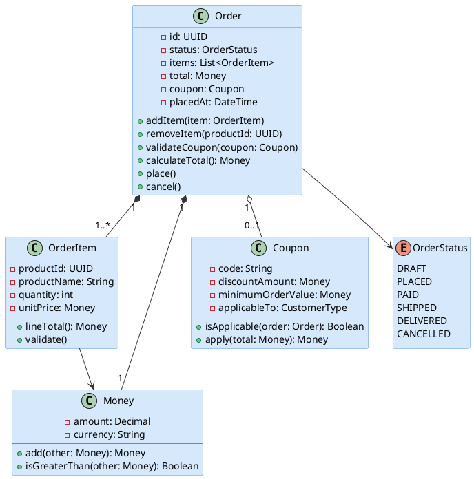
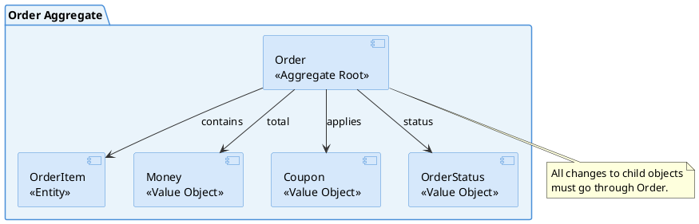
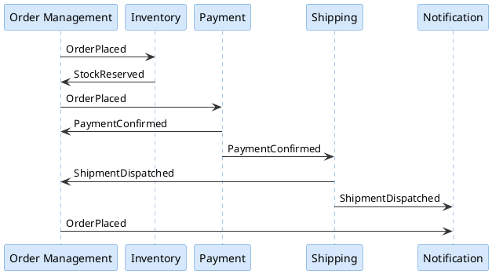

# ✅ Lab D-02 — Solution: Modeling the Domain

> 🗂️ Topic: Domain-Driven Design &nbsp;|&nbsp; 📐 Artifacts: Domain Model · Aggregate Roots · Domain Events &nbsp;|&nbsp; 🔒 Trainer Reference

---

## 🧱 Step 1 — Rich Domain Model

The following solution focuses on the **Order Management** bounded context, as it is the most complex and illustrative context in ShopFast.

### Domain Object Cards

| 🏷️ Object | 📋 Key Attributes | ⚙️ Encapsulated Business Logic |
|---|---|---|
| **Order** | `id`, `status`, `items`, `total`, `coupon`, `placedAt` | Validates coupon eligibility; calculates total; enforces that items cannot be added after placement; transitions status according to allowed lifecycle |
| **OrderItem** | `productId`, `productName`, `quantity`, `unitPrice` | Validates that quantity is greater than zero; calculates line total; ensures unit price is not negative |
| **Money** | `amount`, `currency` | Enforces non-negative amounts; ensures currency consistency when adding two Money values |
| **OrderStatus** | `DRAFT`, `PLACED`, `PAID`, `SHIPPED`, `DELIVERED`, `CANCELLED` | Defines valid transitions — e.g. only a `PLACED` order can transition to `PAID`; a `SHIPPED` order cannot be cancelled |
| **Coupon** | `code`, `discountAmount`, `minimumOrderValue`, `applicableTo` | Validates applicability against order total and customer type (e.g. new users only) |

### PlantUML — Rich Domain Model

> 🔗 Visualize this diagram at **https://editor.plantuml.com/** — paste the code below into the editor.

---

## 👑 Step 2 — Aggregate Roots

### Order Aggregate

The **Order** is the aggregate root of the Order Management context. All modifications to `OrderItem` and `Coupon` must go through the `Order` — they cannot be changed directly from outside.

| 👑 Aggregate Root | 📋 Child Objects | ✏️ Invariants Enforced |
|---|---|---|
| **Order** | `OrderItem`, `Money`, `Coupon` | Items may only be added or removed while the order is in `DRAFT` status; the total must always reflect the current items and any applied coupon; a coupon can only be applied if the minimum order value is met |

> **Note for trainer:** `Money` is a **value object**, not an entity — it has no identity of its own and is defined entirely by its value. This is a good discussion point with the group.

### PlantUML — Aggregate Structure

> 🔗 Visualize this diagram at **https://editor.plantuml.com/** — paste the code below into the editor.

---

## ⚡ Step 3 — Domain Events

The following events cover the full order lifecycle in ShopFast, arranged in business sequence.

| ⚡ Event | 🎯 Trigger | 👂 Consumers |
|---|---|---|
| `OrderPlaced` | Customer confirms the order | Inventory (reserve stock), Payment (initiate payment request), Notification (send confirmation email) |
| `StockReserved` | Inventory successfully reserves all items | Order Management (unblock order progress) |
| `StockReservationFailed` | One or more items are out of stock | Order Management (cancel order), Notification (inform customer) |
| `PaymentConfirmed` | Payment Provider confirms successful payment | Order Management (transition to PAID), Shipping (initiate shipment) |
| `PaymentFailed` | Payment Provider rejects the payment | Order Management (cancel order), Inventory (release reserved stock), Notification (inform customer) |
| `ShipmentDispatched` | Logistics Provider confirms handover | Order Management (transition to SHIPPED), Notification (send tracking info to customer) |
| `OrderDelivered` | Logistics Provider confirms delivery | Order Management (transition to DELIVERED), Analytics (record completed order event) |
| `OrderCancelled` | Customer or system cancels the order | Inventory (release reserved stock), Payment (initiate refund if paid), Notification (inform customer) |

### PlantUML — Domain Event Flow

> 🔗 Visualize this diagram at **https://editor.plantuml.com/** — paste the code below into the editor.

---

## 💡 Trainer Notes

- Groups may struggle with whether `Customer` belongs inside the Order aggregate. It does not — the Order only holds a `customerId` reference. The `Customer` is the aggregate root of a separate **Customer** bounded context.
- The distinction between **domain service** and **application service** often comes up here: `calculateTotal()` belongs in the domain; orchestrating the full checkout flow (calling inventory, payment, and notifications in sequence) belongs in an application service.
- If a group models `StockReserved` as a synchronous response rather than an event, use it as a discussion point — both are valid, but the event-driven approach enables loose coupling between bounded contexts, which is essential for microservices.
- The `Money` value object is a classic DDD teaching moment — encourage groups to think about why precision and currency consistency should not be the caller's responsibility.
