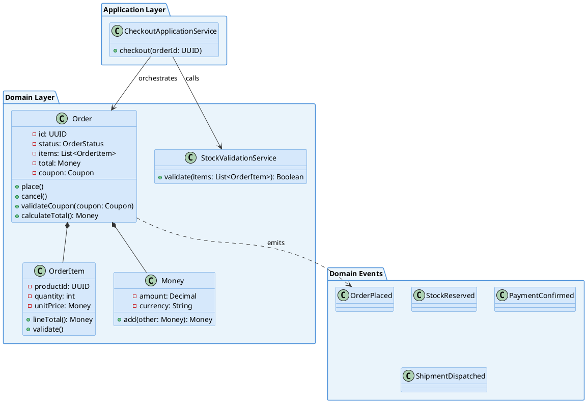
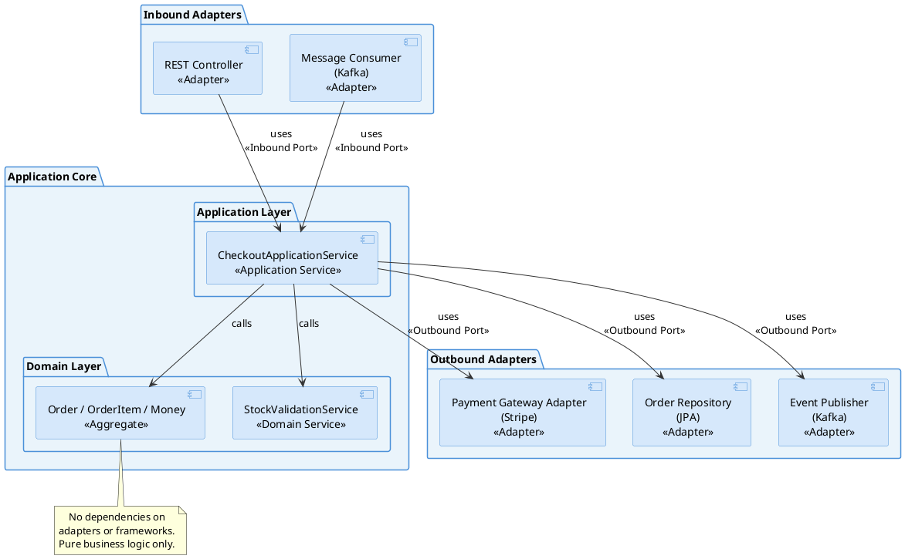

# ✅ Lab D-03 — Solution: Full Design & Architecture

> 🗂️ Topic: Domain-Driven Design &nbsp;|&nbsp; 📐 Artifacts: Full DDD Design · Hexagonal Architecture &nbsp;|&nbsp; 🔒 Trainer Reference

---

## 🛒 Step 1 — Full DDD Design for the Checkout Process

### Layer Overview

| 🏷️ Layer | 📋 Responsibility | 🧩 Components |
|---|---|---|
| **Domain Layer** | Business rules and invariants | `Order`, `OrderItem`, `Money`, `Coupon`, `OrderStatus`, `StockValidationService` |
| **Application Layer** | Use case orchestration | `CheckoutApplicationService` |
| **Domain Events** | Communication between bounded contexts | `OrderPlaced`, `PaymentConfirmed`, `StockReserved`, `ShipmentDispatched` |

---

### 👑 Aggregate Root & Domain Objects

| 🏷️ Object | 🔖 Type | ⚙️ Business Rules |
|---|---|---|
| **Order** | Aggregate Root | Items cannot be modified after placement; total must always be recalculated after changes; status transitions must follow the defined lifecycle |
| **OrderItem** | Entity | Quantity must be greater than zero; unit price must not be negative |
| **Money** | Value Object | Currency must match when adding two values; amount must not be negative |
| **Coupon** | Value Object | Applicable only if order total meets the minimum value; restricted to eligible customer types |
| **OrderStatus** | Value Object | Valid transitions: `DRAFT → PLACED → PAID → SHIPPED → DELIVERED`; `PLACED` and `PAID` may transition to `CANCELLED` |

---

### 🔀 Domain Service vs. Application Service

| 🏷️ Service | 🔖 Type | ⚙️ Responsibility |
|---|---|---|
| **StockValidationService** | Domain Service | Validates stock availability across multiple `OrderItem` entities — logic that spans the aggregate but belongs to the business domain |
| **CheckoutApplicationService** | Application Service | Orchestrates the full checkout flow: loads the order, calls the domain service, delegates payment to the outbound port, and publishes domain events |

---

### ⚡ Domain Event Sequence

| # | ⚡ Event | 🎯 Emitted by | 👂 Consumed by |
|---|---|---|---|
| 1 | `OrderPlaced` | Order Management | Inventory, Payment, Notification |
| 2 | `StockReserved` | Inventory | Order Management |
| 3 | `PaymentConfirmed` | Payment | Order Management, Shipping |
| 4 | `ShipmentDispatched` | Shipping | Order Management, Notification |

---

### PlantUML — Full DDD Checkout Design

> 🔗 Visualize this diagram at **https://editor.plantuml.com/** — paste the code below into the editor.

---

## 🔷 Step 2 — Hexagonal Architecture: Order Management

### PlantUML — Hexagonal Architecture

> 🔗 Visualize this diagram at **https://editor.plantuml.com/** — paste the code below into the editor.

### Port & Adapter Overview

| 🔌 Port | 🔖 Direction | 🔧 Adapter | 📋 Purpose |
|---|---|---|---|
| `CheckoutUseCase` | Inbound | REST Controller | Exposes checkout as an HTTP endpoint |
| `OrderEventConsumer` | Inbound | Kafka Consumer | Reacts to events from other bounded contexts |
| `PaymentPort` | Outbound | Stripe Adapter | Delegates payment processing to the payment provider |
| `OrderRepository` | Outbound | JPA Repository | Persists and retrieves order aggregates |
| `EventPublisher` | Outbound | Kafka Producer | Publishes domain events to the message broker |

---

## 💡 Trainer Notes

- Groups often place the `CheckoutApplicationService` inside the domain layer. Clarify that application services orchestrate but do not contain business logic — they belong in the application layer, one step outside the domain.
- The key insight of hexagonal architecture is the **dependency rule**: adapters depend on ports, never the other way around. The domain has no import of any framework, database, or external library.
- If a group asks whether each bounded context becomes a microservice: yes, this is exactly the goal. One bounded context = one hexagon = one independently deployable service. This is a good bridge to the microservices topic.
- The `StockValidationService` is a domain service because it reasons about business rules across multiple `OrderItem` entities. If it were calling a database or an API, it would need to do so through an outbound port — the domain service itself must remain pure.
