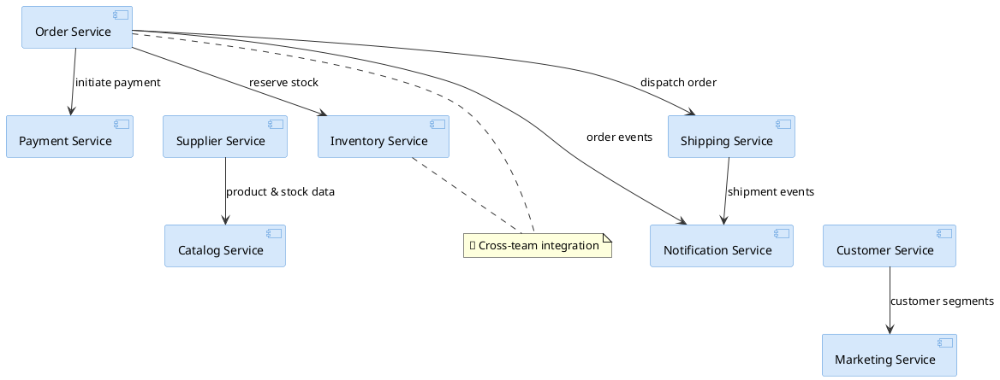

# ✅ Lab MS-01 — Solution: Service Decomposition

> 🗂️ Topic: Microservice Architecture &nbsp;|&nbsp; 📐 Artifacts: Service Map · Team Ownership &nbsp;|&nbsp; 🔒 Trainer Reference

---

## 🗂️ Step 1 — Microservice Definitions

Each bounded context from the DDD labs maps to one microservice. The table below defines each service's responsibility, data ownership, and explicit non-responsibilities.

| 🏷️ Service | 🎯 Business Capability | 📦 Data Owned | 🚫 Does NOT do |
|---|---|---|---|
| **Catalog Service** | Manages the browsable product catalog — descriptions, pricing, images, categories, and search. | Product, Category, Price, SKU | Does not track stock levels — that is Inventory's responsibility |
| **Inventory Service** | Manages stock levels and reservations for each SKU — prevents overselling. | StockItem, Reservation, StockLevel | Does not know about orders or customers — only SKUs and quantities |
| **Order Service** | Handles the full order lifecycle from placement to completion or cancellation. | Order, OrderItem, OrderStatus, Coupon | Does not process payment or dispatch shipments — delegates to dedicated services |
| **Payment Service** | Processes payments by delegating to the external payment provider and recording outcomes. | Payment, PaymentStatus, Invoice | Does not store card data — that stays with the payment provider |
| **Shipping Service** | Hands off orders to the logistics provider and surfaces tracking information back to the system. | Shipment, TrackingInfo, DeliveryStatus | Does not physically ship anything — orchestrates the external logistics provider |
| **Customer Service** | Manages customer accounts, registration, authentication data, and delivery addresses. | Customer, DeliveryAddress | Does not manage sessions or issue tokens — that is the responsibility of the identity provider |
| **Notification Service** | Sends transactional messages (email, SMS) to customers triggered by business events. | Notification, NotificationStatus | Does not decide when to notify — reacts to domain events from other services |
| **Marketing Service** | Manages customer segmentation and dispatches campaigns via the external email marketing platform. | Campaign, CustomerSegment | Does not send emails directly — delegates to the email marketing platform |
| **Supplier Service** | Manages the supplier portal — allowing suppliers to register products and update delivery quantities. | Supplier, DeliveryQuantity | Does not own the product master data — submits data to the Catalog Service |

---

## 👥 Step 2 — Team Ownership

| 🏷️ Service | 👥 Team | 🧠 Core Competencies Needed |
|---|---|---|
| Catalog Service | **Team Catalog** | Product data modelling, search/indexing (e.g. Elasticsearch), media handling |
| Inventory Service | **Team Catalog** | Concurrent stock management, distributed locking, eventual consistency |
| Order Service | **Team Orders** | Complex domain modelling, state machine design, event-driven patterns |
| Payment Service | **Team Orders** | Payment provider integration, PCI-DSS awareness, financial data handling |
| Shipping Service | **Team Fulfillment** | Logistics provider APIs, tracking integration, webhook handling |
| Customer Service | **Team Customer** | Identity management, GDPR compliance, profile data security |
| Notification Service | **Team Customer** | Email/SMS delivery, template management, retry and delivery tracking |
| Marketing Service | **Team Marketing** | Data segmentation, campaign tooling, external platform integration |
| Supplier Service | **Team Catalog** | B2B portal design, supplier onboarding, bulk data ingestion |

> ⚠️ **Ownership conflicts to discuss:**
> - **Inventory + Catalog** both owned by Team Catalog — they change together frequently (new products = new stock entries), which justifies this. Monitor for coupling over time.
> - **Payment + Order** both owned by Team Orders — payment is tightly coupled to the order lifecycle in ShopFast. If payment logic grows, consider splitting into a dedicated team.

---

## 🗺️ Step 3 — Service Map

### Communication Dependencies

| ➡️ From | ⬅️ To | 📋 Purpose | 🔴 Cross-Team? |
|---|---|---|---|
| Order Service | Inventory Service | Reserve stock when order is placed | ✅ Yes (Orders → Catalog) |
| Order Service | Payment Service | Initiate payment after stock reservation | ❌ No (same team) |
| Order Service | Shipping Service | Dispatch order after payment confirmed | ✅ Yes (Orders → Fulfillment) |
| Order Service | Notification Service | Notify customer of order confirmation and updates | ✅ Yes (Orders → Customer) |
| Shipping Service | Notification Service | Notify customer when shipment is dispatched | ❌ No (same team) |
| Supplier Service | Catalog Service | Submit new products and stock updates | ❌ No (same team) |
| Customer Service | Marketing Service | Provide anonymised customer segments | ✅ Yes (Customer → Marketing) |

### PlantUML — Service Map

> 🔗 Visualize this diagram at **https://editor.plantuml.com/** — paste the code below into the editor.

---

## 💡 Trainer Notes

- Groups often want to create a **single "backend" service** or fold Inventory into Order. Challenge them: if a Black Friday sale hits, which service needs to scale independently — and why?
- The **Notification Service** as a standalone service is sometimes questioned. Make the case: if every service sends emails, who owns the template? Who handles bounces? Centralisation makes sense here.
- **Conway's Law** is best illustrated by pointing out the cross-team connections (marked in red). Ask: *how much communication overhead does each of these connections create between teams?*
- A **Supplier Service** is sometimes merged into Catalog. Valid — but note that supplier-facing concerns (portal UX, bulk uploads, supplier auth) are different from customer-facing catalog concerns.
- Some groups will identify a **Search Service** as a separate microservice. This is architecturally sound (separate index from the catalog store) and worth discussing if raised.
