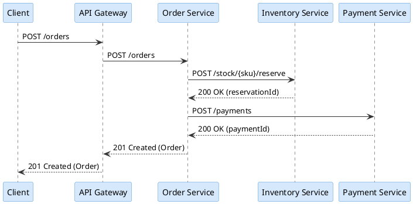
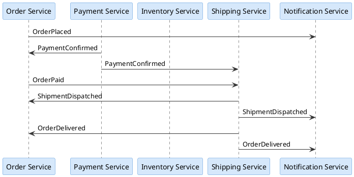

# ✅ Lab MS-03 — Solution: Integration Design

> 🗂️ Topic: Microservice Architecture &nbsp;|&nbsp; 📐 Artifacts: Integration Map · REST API · Event Flow &nbsp;|&nbsp; 🔒 Trainer Reference

---

## 🔀 Step 1 — Integration Style Decisions

| 🔗 From → To | 🔄 Style | ✅ Justification | ⚠️ Trade-off Accepted |
|---|---|---|---|
| **Client → Order Service** | Synchronous (REST) | The customer needs immediate confirmation that their order was placed successfully | Tighter coupling between client and Order Service; client blocks while waiting |
| **Order Service → Inventory Service** | Synchronous (REST) | Stock availability must be confirmed before the order can proceed — an async check risks overselling | Inventory becomes a synchronous dependency; if it is slow, checkout slows |
| **Order Service → Payment Service** | Synchronous (REST) | Payment confirmation is required before the order can advance — the customer is actively waiting | Payment gateway latency directly affects checkout response time |
| **Order Service → Notification Service** | Asynchronous (event) | Sending a confirmation email is not time-critical for the business flow — the order is already placed | Email may arrive with a short delay; acceptable for transactional notifications |
| **Payment Service → Order Service** | Asynchronous (event) | `PaymentConfirmed` or `PaymentFailed` arrives as a webhook/event from the payment provider — Order Service reacts | Order Service must handle delayed or out-of-order events |
| **Order Service → Shipping Service** | Asynchronous (event) | Shipment dispatch is triggered after payment confirmation, not during checkout — no immediate response needed | Shipping Service must handle `OrderPaid` events idempotently |
| **Shipping Service → Order Service** | Asynchronous (event) | Tracking updates arrive asynchronously from the logistics provider — push model is most natural | Order Service must poll or subscribe for status; tracking may lag |
| **Shipping Service → Notification Service** | Asynchronous (event) | Shipment notifications are triggered by logistics events, not user actions | Notification delay is acceptable here |
| **Customer Service → Marketing Service** | Asynchronous (event / batch) | Segment data is not time-critical; batch transfer or event-based sync is sufficient | Marketing data may be slightly stale |

---

## 🌐 Step 2 — REST API Design

### Order Service — REST Endpoints (Richardson Maturity Level 2)

| 🔤 Method | 🌐 Path | ➡️ Request | ⬅️ Success Response | ⚠️ Error Codes |
|---|---|---|---|---|
| `POST` | `/orders` | Body: `{ customerId, items, couponCode? }` | `201 Created` + Order object | `400`, `409` (stock), `422` (coupon) |
| `GET` | `/orders/{id}` | Path param: `id` | `200 OK` + Order object | `404`, `403` |
| `GET` | `/customers/{customerId}/orders` | Path + query: `?page&size` | `200 OK` + paginated list | `403`, `404` |
| `PATCH` | `/orders/{id}/cancel` | Path param: `id` | `200 OK` + updated Order | `404`, `403`, `409` (already shipped) |

### Inventory Service — REST Endpoints

| 🔤 Method | 🌐 Path | ➡️ Request | ⬅️ Success Response | ⚠️ Error Codes |
|---|---|---|---|---|
| `GET` | `/stock/{skuId}` | Path param: `skuId` | `200 OK` + `{ skuId, available, reserved }` | `404` |
| `POST` | `/stock/{skuId}/reserve` | Body: `{ orderId, quantity }` | `200 OK` + `{ reservationId, expiresAt }` | `409` (insufficient stock), `404` |
| `DELETE` | `/stock/reservations/{reservationId}` | Path param: `reservationId` | `204 No Content` | `404` |

### PlantUML — REST Interaction (Checkout Flow)

> 🔗 Visualize this diagram at **https://editor.plantuml.com/** — paste the code below into the editor.

---

## ⚡ Step 3 — Event-Driven Integration

### Event Flow Cards (in business sequence)

| # | ⚡ Event | 📢 Producer | 📦 Payload | 👂 Consumers | 🔁 If Consumer Unavailable |
|---|---|---|---|---|---|
| 1 | `OrderPlaced` | Order Service | `{ orderId, customerId, items, total, placedAt }` | Notification Service | Event queued — notification delayed but order unaffected |
| 2 | `PaymentConfirmed` | Payment Service | `{ orderId, paymentId, amount, confirmedAt }` | Order Service (→ PAID), Shipping Service | Retried with backoff — order stays in PLACED until confirmed |
| 3 | `PaymentFailed` | Payment Service | `{ orderId, paymentId, reason, failedAt }` | Order Service (→ CANCELLED), Inventory Service (release), Notification Service | Retried — if unresolvable, manual intervention required |
| 4 | `OrderPaid` | Order Service | `{ orderId, customerId, shippingAddress, items }` | Shipping Service | Event queued — dispatch delayed but order state is already PAID |
| 5 | `ShipmentDispatched` | Shipping Service | `{ orderId, shipmentId, trackingNumber, carrier, dispatchedAt }` | Order Service (→ SHIPPED), Notification Service | Retried — order stays PAID, customer not notified until processed |
| 6 | `OrderDelivered` | Shipping Service | `{ orderId, shipmentId, deliveredAt }` | Order Service (→ DELIVERED), Notification Service | Retried — delivery confirmation delayed but non-critical |
| 7 | `OrderCancelled` | Order Service | `{ orderId, customerId, reason, cancelledAt }` | Inventory Service (release stock), Payment Service (refund), Notification Service | Retried — financial operations must not be lost |

### PlantUML — Asynchronous Event Flow

> 🔗 Visualize this diagram at **https://editor.plantuml.com/** — paste the code below into the editor.

---

## 💡 Trainer Notes

- The **Order Service → Inventory Service** sync call is the most debated decision. Some groups will propose making it async. The counter-argument: if you don't check stock synchronously, you cannot return a meaningful error to the customer during checkout. Async stock validation leads to a worse user experience.
- The **Payment Service → Order Service** relationship is naturally event-driven — payment providers send webhooks asynchronously. This is a real-world example of why some interactions are async by necessity, not just by preference.
- Groups sometimes propose making all communication async to "maximise decoupling". Use this as a teachable moment: async communication shifts complexity from latency to consistency. Neither is free.
- **Idempotency** should be mentioned in the context of `OrderCancelled` → Payment Service refund. If the event is delivered twice, the refund must not be processed twice. This is a natural lead-in to the resilience lab.
- The `OrderPaid` event after synchronous payment confirmation is a good example of the **event-carried state transfer** pattern — the Shipping Service needs order details but should not query the Order Service synchronously.
