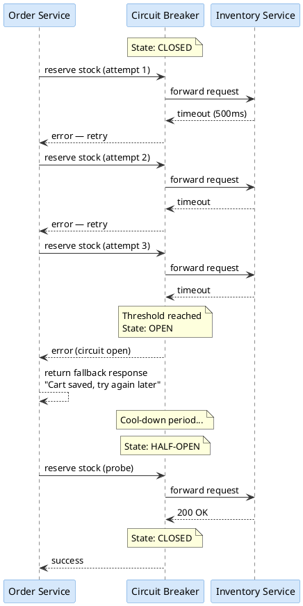

# ✅ Lab MS-04 — Solution: Failure Scenarios & Resilience

> 🗂️ Topic: Microservice Architecture &nbsp;|&nbsp; 📐 Artifacts: Failure Map · Resilience Patterns &nbsp;|&nbsp; 🔒 Trainer Reference

---

## 💥 Step 1 — Failure Scenarios

| 💥 Failure Scenario | 🌊 Blast Radius | 👤 User Impact | 🔴 Severity |
|---|---|---|---|
| **Inventory Service is unreachable** | Order Service cannot reserve stock — checkout fails entirely | Customer cannot place any order | Critical |
| **Inventory Service is slow (high latency)** | Order Service thread pool exhausts waiting for response — cascades to all checkout requests | Checkout becomes slow for all customers, eventually times out | Critical |
| **Payment Service is unreachable** | Order Service cannot initiate payment — order stuck after stock reservation | Customer sees an error at payment step; reserved stock may not be released | Critical |
| **Payment Provider webhook delayed** | `PaymentConfirmed` event not received — order stuck in PLACED state; shipment not triggered | Customer sees order "pending" indefinitely | High |
| **Shipping Service is unreachable** | `OrderPaid` event not consumed — order paid but not dispatched | Customer sees payment taken but no shipment update | High |
| **Notification Service is down** | Emails and SMS not sent — order confirmations and shipment updates lost | Customer receives no transactional emails; support calls increase | Medium |
| **Order Service crashes mid-checkout** | In-flight orders may be in inconsistent state (stock reserved, payment not initiated) | Customer may be charged or stock reserved without a completed order | Critical |
| **Catalog Service is down** | Product browsing and search unavailable — new orders cannot be started | Customer cannot browse or search products | High |

---

## 🛡️ Step 2 — Resilience Pattern Cards

| 💥 Failure | 🛡️ Pattern | 📋 How it applies to ShopFast | ✅ Protects against | ⚠️ Trade-off |
|---|---|---|---|---|
| Inventory slow / unreachable | **Timeout** | Order Service sets a hard timeout (e.g. 500ms) on the `/stock/reserve` call | Caller is not blocked indefinitely | Legitimate slow responses are also cut off |
| Inventory slow / unreachable | **Circuit Breaker** | After N consecutive failures, Order Service stops calling Inventory and returns an error immediately; retries after a cool-down period | Prevents cascade overload on Inventory during recovery | Customer cannot check out while circuit is open |
| Inventory slow / unreachable | **Retry with Backoff** | Order Service retries the stock reservation up to 3 times with exponential backoff (100ms, 200ms, 400ms) | Handles transient network blips | Risk of overloading a recovering service without jitter |
| Payment Service unreachable | **Circuit Breaker + Fallback** | Circuit breaker stops payment calls; fallback returns a clear user-facing error: "payment temporarily unavailable, your cart is saved" | Prevents thread exhaustion | Customer cannot complete checkout during outage |
| Payment webhook delayed | **Idempotent Event Handling** | Order Service processes `PaymentConfirmed` idempotently — processing it twice has no effect | Duplicate webhook deliveries do not cause double-processing | Slightly more complex event handler logic |
| Order stuck mid-checkout | **Idempotency Key** | Checkout requests include a client-generated idempotency key; Order Service rejects duplicates safely | Retrying a failed checkout does not create duplicate orders | Client must generate and store idempotency keys |
| Notification Service down | **Async Queue (Dead Letter Queue)** | Notification events are written to a durable message queue; if Notification Service is down, events are retried; undeliverable events go to a Dead Letter Queue for investigation | Email delivery is not blocking for the order flow | Emails may be delayed; DLQ needs monitoring |
| Shipping Service delayed | **Async Queue** | `OrderPaid` events are durably queued; Shipping Service consumes when available | Order state is preserved; shipment delayed but not lost | Customer may not see immediate shipment confirmation |
| Catalog Service down | **Response Cache** | API Gateway or Catalog Service caches product responses (e.g. 5-minute TTL); stale but available during outage | Product browsing continues with slightly stale data | Price or stock changes not immediately visible |

---

## 🔁 Step 3 — End-to-End Walkthrough: Inventory Service Failure During Checkout

This is the most critical failure scenario. Here is the step-by-step walkthrough:

### Scenario
A customer clicks "Place Order" during a flash sale. The Inventory Service is overwhelmed and not responding.

### Walkthrough

| Step | What happens | Resilience mechanism | Customer experience |
|---|---|---|---|
| 1 | Order Service calls `POST /stock/{sku}/reserve` | Timeout fires after 500ms — no response received | Customer sees "processing..." |
| 2 | Order Service retries twice with backoff (200ms, 400ms) | Retry with backoff — still no response | Checkout is slow but still in progress |
| 3 | After 3 failed attempts, Circuit Breaker records a failure | Circuit Breaker threshold reached on next requests | — |
| 4 | Subsequent checkout requests hit the open circuit immediately | Circuit Breaker returns error instantly — no more calls to Inventory | Error response is now fast instead of slow |
| 5 | Order Service returns a structured error to the customer | Fallback: "We're unable to confirm stock right now. Your cart has been saved." | Customer sees a clear, friendly error; cart is preserved |
| 6 | After cool-down period (e.g. 30s), Circuit Breaker enters half-open state | One test request is sent to Inventory | — |
| 7 | Inventory recovers and responds successfully | Circuit Breaker closes — normal operation resumes | Checkout works again |

### PlantUML — Circuit Breaker Flow

> 🔗 Visualize this diagram at **https://editor.plantuml.com/** — paste the code below into the editor.

---

## 💡 Trainer Notes

- The **Inventory Service slow** scenario is more dangerous than "unreachable" — a slow service causes thread exhaustion through queuing, while an unreachable service fails fast. This distinction is important and not immediately obvious.
- Groups often only apply one pattern per failure. Emphasise that patterns compose: **Timeout + Retry + Circuit Breaker** is the standard trio for any synchronous call. Each addresses a different dimension of the problem.
- **Idempotency** is frequently overlooked. Use the double-refund scenario (cancellation event delivered twice → two refunds) to make the risk concrete.
- The **Dead Letter Queue** pattern for the Notification Service is a good illustration that resilience does not always mean immediate recovery — sometimes it means "don't lose the work".
- Ask groups: *what is the right user experience when checkout fails?* The answer shapes the fallback design. "Your cart is saved" is very different from "Error 500".
