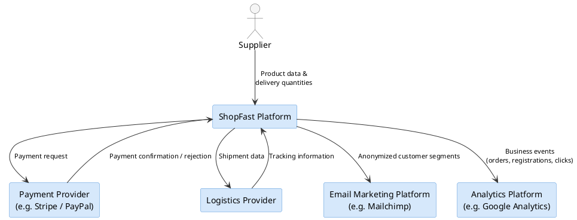

# ✅ Lab RE-01 — Solution: Context Model

> 🗂️ Topic: Requirements Engineering &nbsp;|&nbsp; 📐 Artifact: Context Model &nbsp;|&nbsp; 🔒 Trainer Reference

---

## 🔍 Step 1 — Case Study Analysis

### 🌐 External Systems

| External System | Purpose |
|---|---|
| 💳 Payment Provider *(e.g. Stripe, PayPal)* | Processes customer payments; ShopFast delegates all payment handling |
| 🚚 Logistics Provider | Handles physical shipment; provides tracking information back to ShopFast |
| 📧 Email Marketing Platform *(e.g. Mailchimp)* | Executes marketing campaigns based on customer segments supplied by ShopFast |
| 📊 Analytics Platform *(e.g. Google Analytics, Data Warehouse)* | Receives business events for reporting and business intelligence |

### 🎯 Core Responsibilities of ShopFast

- Product catalog management (search, filtering, product detail pages)
- Shopping cart and order placement
- Customer account management (registration, order history, shipment tracking)
- Inventory management (stock level tracking, oversell prevention)
- Back-office admin tool (product data, pricing, stock updates)
- Supplier portal (product registration, delivery quantity updates)
- Order-triggered email notifications to customers

### ↔️ Data & Event Flows

| Direction | Data / Event |
|---|---|
| ➡️ ShopFast → Payment Provider | Payment request (amount, order reference) |
| ⬅️ Payment Provider → ShopFast | Payment confirmation or rejection |
| ➡️ ShopFast → Logistics Provider | Shipment data (address, items, order ID) |
| ⬅️ Logistics Provider → ShopFast | Tracking information and delivery status |
| ➡️ ShopFast → Email Marketing Platform | Anonymized customer segments |
| ➡️ ShopFast → Analytics Platform | Business events (orders, registrations, clicks) |
| ⬅️ Supplier Portal → ShopFast | New product data, stock/delivery quantity updates |

---

## 🗺️ Step 2 — Context Model

> 🔗 Visualize this diagram at **https://editor.plantuml.com/** — paste the code below into the editor.

---

## 💡 Trainer Notes

- **Supplier** is an external actor, not a system — the supplier portal is an internal component of ShopFast that exposes an interface to suppliers.
- Groups may initially include **email notifications to customers** as an external system. This is a valid discussion point: ShopFast can send emails directly (internal) or delegate to a transactional email service (external, e.g. SendGrid). Both are acceptable — the key learning is to make the boundary decision explicit and justify it.
- The **analytics platform** and **email marketing platform** are outbound-only integrations — no data flows back into ShopFast. This is worth highlighting when reviewing the arrows.
- If a group includes an **identity provider** (e.g. OAuth / SSO) as an external system, that is a valid architectural choice worth discussing, even though it is not mentioned in the case study.
- The context model should deliberately remain at a high level of abstraction — discourage groups from modeling internal components at this stage.
